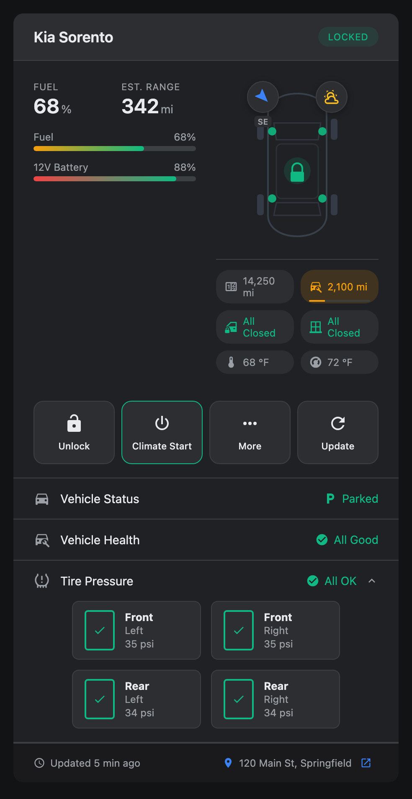
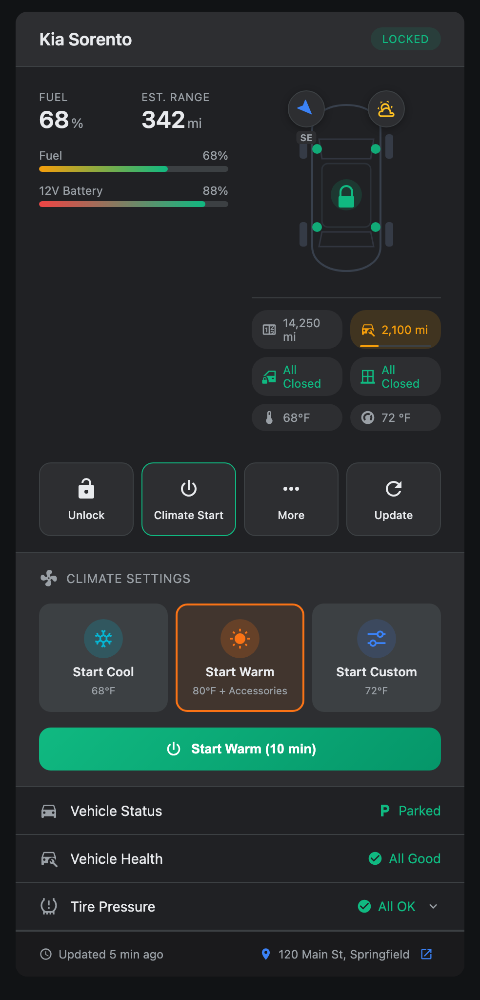
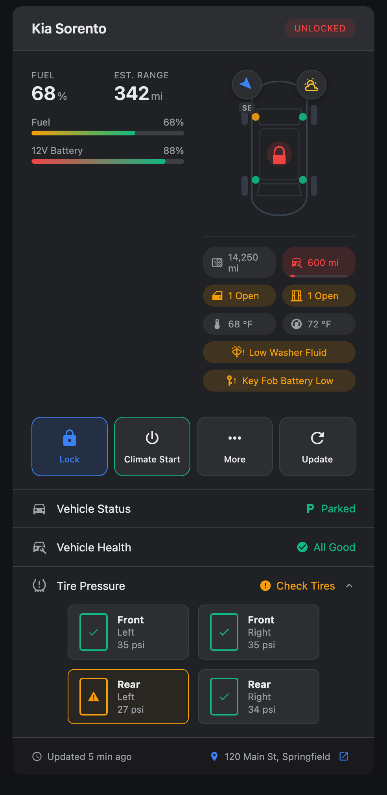
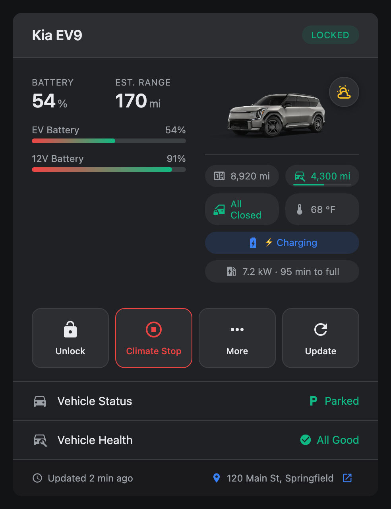
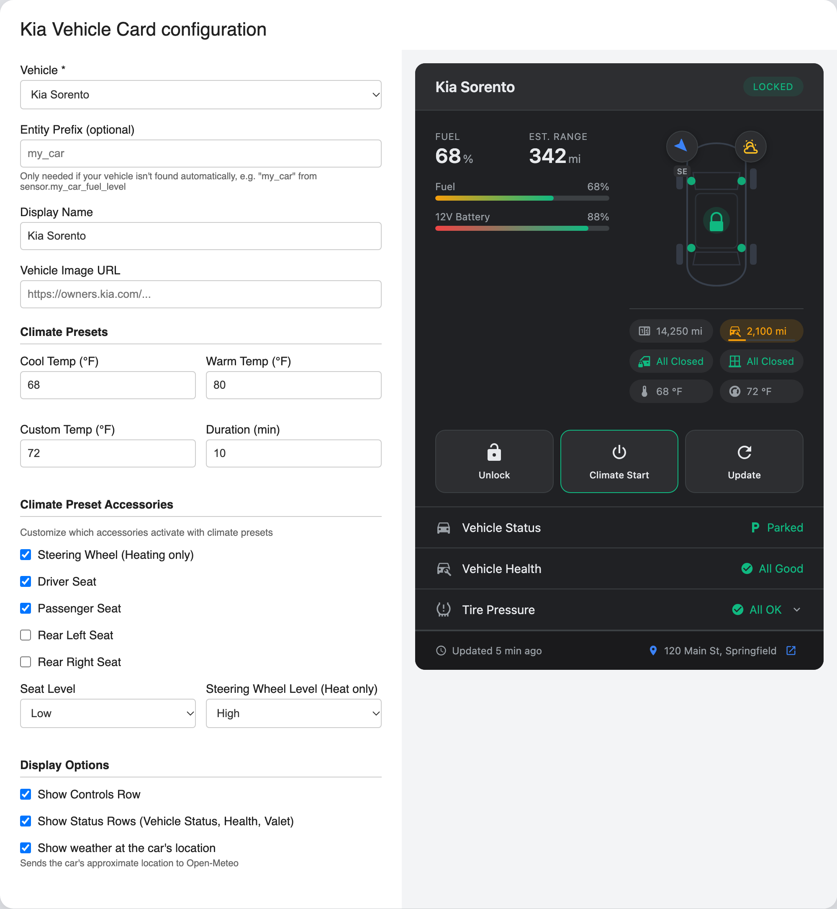

# Kia Vehicle Card for Home Assistant

A dashboard card for Kia, Hyundai and Genesis vehicles that use the [Kia UVO / Hyundai Bluelink integration](https://github.com/Hyundai-Kia-Connect/kia_uvo).

The card only shows what your vehicle actually reports. If a sensor doesn't exist on your car, is temporarily unavailable, or a command can't be sent in your region, that part of the card is hidden. You never see a made-up "All Closed" or a button that does nothing.

| Overview | Climate presets |
| :---: | :---: |
|  |  |
| **Alerts** | **EV charging** |
|  |  |

Screenshots use demo data.

## Features

**At a glance**
- Fuel, EV battery and 12V battery, with estimated range
- Locked, unlocked or running badge
- Doors and windows, plus a car diagram that colours each door
- Odometer and a colour-coded service countdown
- Heading compass and the car's location, which opens in Google Maps
- Average fuel economy, where the car reports it

**Status**
- Vehicle status: Parked, Driving (only when a road speed proves it), Remote Start or Engine On
- Speed while driving, and drive mode and gear while the ignition is on, where the car reports them
- Vehicle health from diagnostic trouble codes
- Tire pressure warnings and, where available, each tire's pressure
- Valet mode

**Alerts**, shown only while active
- Low washer fluid, low fuel, key fob battery, brake fluid, engine oil and 12V battery fault
- Headlamp, brake light, turn signal and tail lamp faults
- Hazard lights on

**Electric and plug-in hybrid vehicles**
- Full EVs lead with battery and range; plug-in hybrids show both fuel and EV battery
- Charging and plugged-in status, with charging power and time to full while charging

**Climate**
- Cool, Warm and Custom presets, with heated or ventilated seats and steering wheel for Warm
- Temperatures follow your region: °F in the USA, °C elsewhere
- A "Climate Active" row showing which heaters and seats are on

**Controls**
- Lock and unlock. Unlocking asks for a second tap to confirm
- Start and stop climate, and request a fresh update from the car
- A **More** menu with Find My Car, Horn + Lights and Flash Lights

**Optional weather at the car's location**, from [Open-Meteo](https://open-meteo.com). It's off by default and turned on in the card's editor.

## What you'll see depends on your car

Each region's API reports different data and supports different commands. A few examples:

- **Kia USA** doesn't report drive mode, gear or fuel economy, and the integration can't send horn, lights or valet commands there, so those are hidden. Kia USA also always reports the same weather, so the weather badge only appears when **Show weather at the car's location** is turned on.
- **Valet mode** can only be switched from the card outside the USA. Elsewhere its status is still shown.
- **Rows like 12V warning level, link status and roadside assistance** appear only with integration builds that provide them.

## Installation

### HACS (recommended)

1. Open HACS (shown as **Marketplace** in recent Home Assistant versions).
2. Open the three-dot menu and choose **Custom repositories**.
3. Add `https://github.com/auadix/ha-kia-card` with the category **Dashboard**.
4. Find **Kia Vehicle Card**, download it, then hard-refresh your browser (Ctrl/Cmd+Shift+R).

### Manual

1. Download `kia-vehicle-card.js` from the [latest release](https://github.com/auadix/ha-kia-card/releases/latest).
2. Copy it to `<config>/www/kia-vehicle-card.js`.
3. Under **Settings → Dashboards → Resources**, add `/local/kia-vehicle-card.js` as a JavaScript module.
4. Hard-refresh your browser.

## Configuration

Everything is set up in the card's editor. Edit your dashboard, add **Kia Vehicle Card**, and pick your car from the **Vehicle** list. The card finds the rest on its own, including the device the controls need.

Demo data.

### Vehicle

- **Vehicle**: the car to show. Pick it here and the card finds its sensors, even if you've renamed them.
- **Entity Prefix**: leave this empty unless your car isn't found. Then enter the start of its entity names, for example `my_car` from `sensor.my_car_fuel_level`.
- **Display Name**: the name in the card's header.
- **Vehicle Image URL**: a picture of your car. Without one, the card draws a diagram that shows each door's state.

### Climate presets

- **Cool, Warm and Custom Temp**: the temperature each preset sets, in your region's unit (°F in the USA, °C elsewhere).
- **Duration**: how long climate runs, in minutes.

### Climate preset accessories

What the **Warm** preset turns on with the heat:

- **Steering Wheel**, **Driver Seat**, **Passenger Seat**, **Rear Left Seat** and **Rear Right Seat**
- **Seat Level**: Low, Medium or High
- **Steering Wheel Level**: Low or High

### Display options

- **Show Controls Row**: the lock, climate, More and Update buttons.
- **Show Status Rows**: vehicle status, health, tire pressure and valet.
- **Show weather at the car's location**: off by default. See [Privacy](#privacy).

## Requirements

The [Kia UVO / Hyundai Bluelink integration](https://github.com/Hyundai-Kia-Connect/kia_uvo), installed and set up. Newer integration versions name more entities consistently, but the card works with older ones too; it just shows less.

## Troubleshooting

**The card doesn't appear.** Hard-refresh the browser and check that the resource is listed under **Settings → Dashboards → Resources**. The browser console (F12) shows any loading errors.

**A section is missing.** The card only shows what your car reports, so check that the matching entity exists and isn't unavailable. Forcing an update from the integration often helps after a restart.

**A button is missing.** Controls only appear when the integration can perform them for your vehicle and region. If a control also fails from the integration's own actions, the problem is with the integration or the car's subscription.

**Unlock didn't happen.** Unlocking needs a second tap within 4 seconds. The button turns amber and reads "Tap to Confirm" in between.

## Privacy

The card talks only to your Home Assistant, with one exception: with **Show weather at the car's location** turned on, it asks Open-Meteo for the weather at the car's approximate location, about every 30 minutes. Opening the location link sends the coordinates to Google Maps.

## Contributing

Issues and pull requests are welcome. Run the tests with `node --test tests/`. See the [changelog](CHANGELOG.md) for release history.

## Credits

- Built for the [Kia UVO / Hyundai Bluelink integration](https://github.com/Hyundai-Kia-Connect/kia_uvo)
- Icons by [Material Design Icons](https://pictogrammers.com/library/mdi/)
- Weather by [Open-Meteo](https://open-meteo.com)

## License

MIT. See [LICENSE](LICENSE).
